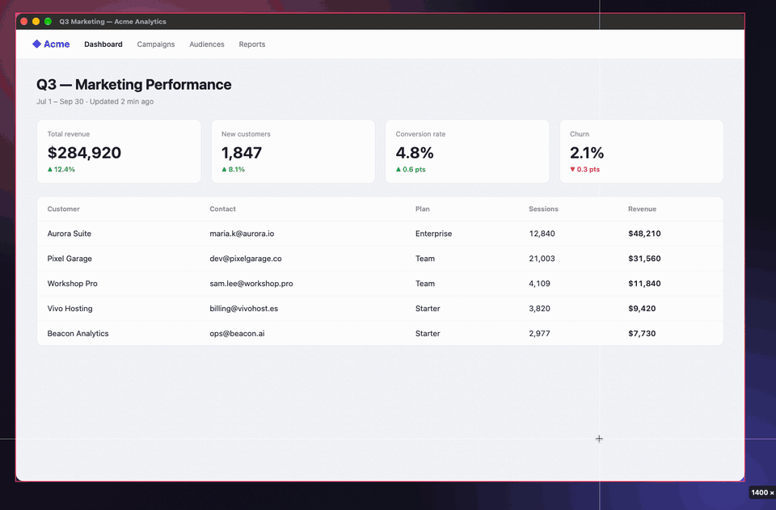
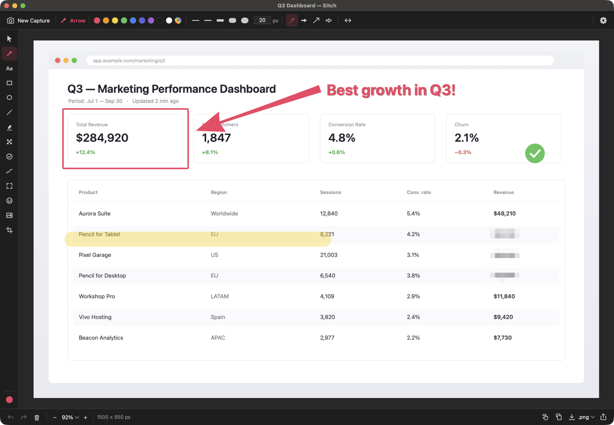

<div align="center">


# Sitch — the free Skitch alternative for Windows and Mac

**Skitch is gone. This is it again.** Press a hotkey, drag over anything on screen, slap the
iconic tapered arrow on it, blur the secrets, and paste it into Slack — in about three seconds.
Free, open source, native on both platforms, and nothing ever leaves your computer.

[](https://github.com/phalladar/sitch/releases/latest)
[](LICENSE)
[](#requirements)
[](#requirements)
[](https://github.com/phalladar/sitch/stargazers)

### [⬇️ Download for Windows](https://github.com/phalladar/sitch/releases/latest/download/WinSitch.exe) &nbsp;·&nbsp; [⬇️ Download for Mac](https://github.com/phalladar/sitch/releases/latest/download/Sitch.dmg)

<sub>Windows: one portable .exe, no installer, no admin · Mac: signed & notarized universal app</sub>

<br/>



</div>

## Why people switch to Sitch

- **The Skitch flow, intact.** Hotkey → drag → you're in the editor. No save dialogs, no
  library, no file hunting. Every capture is already on your clipboard.
- **The arrow.** The fat-to-fine tapered arrow Skitch made famous, plus filled, open, concave
  and double-headed styles.
- **Redact properly.** Pixelate, blur, solid block or stripes — flattened into the pixels on
  export, so nobody can peel the redaction off your file.
- **Private by design.** No account, no cloud, no upload links, no telemetry, no network calls.
  Your screenshots never get a public URL.
- **Actually native.** WPF on Windows, Swift + AppKit + ScreenCaptureKit on the Mac. No
  Electron, no web view, no subscription.

> ⭐ **If Sitch fills your Skitch-shaped hole, star the repo.** Stars are how other people
> searching for a Skitch replacement find it.

## Is there still a Skitch for Windows or Mac?

**No.** Evernote discontinued **Skitch for Windows** (along with iOS and Android) in
**January 2016**. **Skitch for Mac** is still listed on the App Store but hasn't been updated
since 2020 and ships as an Intel-only app, so Apple Silicon Macs run it through Rosetta 2 —
which Apple is phasing out after macOS 27.

If you landed here searching for *"Skitch for Windows download"*, *"Skitch alternative for
Mac"* or *"Evernote Skitch replacement"* — Sitch is a clean-room rebuild of that tool, native
on both platforms, with the same one-hotkey snap-and-mark-up workflow.

## Features

### Capture
- **One hotkey for everything** — `Ctrl+Alt+4` on Windows, `⌘⌥4` on Mac (configurable). Drag
  for a region, *click* for a window, or pick a whole display from the tray / menu bar.
- **Recapture the last region** with one keystroke — perfect for before/after shots.
- **Quick capture to clipboard** — skip the editor entirely and just paste.
- **Freeze-frame picker** with a live pixel-size readout and keyboard nudging (arrow keys move,
  `Shift`+arrows resize, `Enter` confirms).
- **Correct on multi-monitor, mixed-DPI and Retina setups** — captures true physical pixels.
- **Clean window capture**, even when the window is partly covered.
- Capture timer (3 / 5 / 10 s) for menus and hover states.
- Optional watcher that opens the editor after a system screenshot (`Win+PrtScn`, or
  `⌘⇧3` / `⌘⇧4` / `⌘⇧5`).

### Annotate — 14 tools
| | |
|---|---|
| **Arrow** | tapered (Skitch-style), filled, open, concave; single or double-headed |
| **Text** | any system font, bold/italic, re-editable later |
| **Shapes** | rectangle, ellipse, line, freehand pen, highlighter |
| **Obscure** | pixelate, blur, solid block, stripes |
| **Spotlight** | dims everything except the thing you're pointing at |
| **Stamps** | ✓ ✕ ★ ● and auto-numbered steps 1 · 2 · 3 for tutorials |
| **Stickers & images** | emoji stickers, image overlays (logos, callouts) |
| **Crop** | non-destructive, with aspect-ratio presets and a rule-of-thirds grid |

Every mark stays an editable object until export: move it, restyle it, or delete it later.
Full undo/redo, rotate/flip (annotations follow), and dark, light or system theme.

### Share & export
- **PNG, JPEG, PDF, TIFF** export
- **Copy at full resolution** — high-DPI shots paste pixel-perfect
- **Drag the image out** of the editor straight into Slack, Teams, Mail, Jira, a browser tab…
- Native **share sheet** on both platforms
- Never saves silently — you always choose where files go

## Download & install

### Windows 10 / 11
**[⬇️ Download Sitch for Windows](https://github.com/phalladar/sitch/releases/latest/download/WinSitch.exe)**
— a single portable ~86 MB `.exe` with the .NET runtime built in. Run it and it lives in your
system tray. That's the whole install; delete the file to uninstall. No admin rights needed.

> The build isn't code-signed yet, so Windows SmartScreen may warn on first run: choose
> *More info → Run anyway*, or [build it from source](#building-from-source).

### macOS 15+ (Apple Silicon & Intel)
**[⬇️ Download Sitch for Mac](https://github.com/phalladar/sitch/releases/latest/download/Sitch.dmg)**
— open the disk image and drag Sitch to Applications. It's a universal app, **signed and
notarized by Apple**, so it opens without Gatekeeper warnings. Sitch lives in your menu bar;
on first launch it walks you through granting **Screen Recording** permission, which macOS
requires for every screenshot app. A plain
[.zip](https://github.com/phalladar/sitch/releases/latest/download/Sitch-macOS.zip) is also
available.

All versions and release notes: [Releases](https://github.com/phalladar/sitch/releases).

## Keyboard shortcuts

| Action | Windows | Mac |
|---|---|---|
| Capture (drag = region, click = window) | `Ctrl+Alt+4` | `⌘⌥4` |
| Recapture last region | `Ctrl+Alt+Shift+4` | `⌘⌥⇧4` |
| Quick capture to clipboard (skip the editor) | `Ctrl+Alt+Shift+C` | `⌃⌥⌘4` |
| Keyboard capture in the overlay | arrows move · `Shift`+arrows resize · `Enter` confirms | arrows move · `⇧`+arrows resize · `⌥` for 10-pt steps · `Return` confirms |
| Undo / Redo | `Ctrl+Z` / `Ctrl+Y` | `⌘Z` / `⌘⇧Z` |
| Copy flattened image | `Ctrl+C` / `Ctrl+Shift+C` | `⌘C` |
| Save | `Ctrl+S` | `⌘S` |
| Zoom | `Ctrl` `+` / `−` / `0`, `Ctrl`+wheel | `⌘=` / `⌘−` / `⌘0`, `⌘9` to fit |
| Crop: apply / cancel | `Enter` / `Esc` | `Return` / `Esc` |
| Straight lines / squares while drawing | hold `Shift` | hold `⇧` |

All three capture hotkeys are configurable in **Settings ▸ Capture**.
**Windows:** left-click the tray icon to capture; right-click for window, full-screen per
display, quick capture, the timer and Settings. **Mac:** click the menu-bar icon.

## Sitch vs. Skitch

| | Skitch (Evernote) | **Sitch** |
|---|---|---|
| Windows | ❌ discontinued January 2016 | ✅ Windows 10 & 11 |
| Mac | ⚠️ last updated 2020, Intel-only (Rosetta 2) | ✅ macOS 15+, native Apple Silicon + Intel |
| Tapered arrow | ✅ | ✅ plus 3 more styles and double-headed |
| Pixelate | ✅ | ✅ plus blur, solid block, stripes |
| Spotlight, stickers, numbered steps | ❌ | ✅ |
| Account | Evernote-oriented | **None, ever** |
| Price / license | free, closed source | **free, MIT open source** |

## Sitch vs. other screenshot tools

Looking for a **Snagit alternative**, **ShareX for Mac**, **CleanShot X for Windows**, or a
**Lightshot alternative that doesn't upload your screenshots**? Here's how they compare
(prices as of 2026):

| | Windows | Mac | Price | Open source | Uploads to a cloud |
|---|:-:|:-:|---|:-:|---|
| **Sitch** | ✅ | ✅ | **Free** | ✅ MIT | **Never** |
| Snagit | ✅ | ✅ | ~$39 / year subscription | ❌ | optional |
| CleanShot X | ❌ | ✅ | paid licence | ❌ | optional |
| ShareX | ✅ | ❌ | free | ✅ GPL | optional |
| Greenshot | ✅ | paid App Store app | free on Windows | ✅ GPL | optional |
| Lightshot | ✅ | ✅ | free | ❌ | public `prnt.sc` links |
| Snipping Tool / Markup | Windows only | Mac only | built in | ❌ | no |

Sitch isn't trying to be a screen recorder or a cloud-sharing service. It does one thing —
**fast, private screenshot annotation** — and does it identically on both platforms.

## FAQ

**What happened to Skitch?**
Evernote bought Skitch in 2011, ended the Windows, iOS and Android versions in January 2016,
and stopped updating the Mac version in 2020. It never got a native Apple Silicon build.

**Is Sitch really free? What's the catch?**
No catch. It's MIT-licensed open source: no account, no subscription, no "pro" tier, no ads,
no tracking.

**How do I add an arrow to a screenshot on Windows or Mac?**
Press `Ctrl+Alt+4` (Windows) or `⌘⌥4` (Mac), drag over the area, and the editor opens with the
Arrow tool ready. Drag from the tail to the tip. Press `Ctrl+C` / `⌘C` to copy the result.

**How do I blur or hide passwords and personal info in a screenshot?**
Use the **Obscure** tool. For real secrets prefer **solid block or stripes** — blur and
pixelation are filters and can sometimes be partially reversed. Sitch flattens redactions into
the pixels when you export, so nothing can be "un-hidden" from the saved file.

**Does Sitch upload my screenshots anywhere?**
No. Sitch makes no network connections at all. Captures stay in memory and on your clipboard
until *you* save or share them.

**Which versions of Windows and macOS are supported?**
Windows 10 version 1903 or later and all Windows 11 releases (x64). macOS 15 Sequoia or later,
on both Apple Silicon and Intel Macs.

**Why does the Mac version ask for Screen Recording permission?**
macOS requires it for any app that reads the screen, including every screenshot tool. Sitch
uses it only to capture what you select.

**Does it handle multiple monitors and display scaling?**
Yes — capture grabs true physical pixels on mixed-DPI Windows setups and Retina Macs alike.

**Can I change the capture hotkey?**
Yes — Settings ▸ Capture, click the shortcut field, and press any combination.

**Is this the same project as WinSitch?**
Yes. Sitch was called **WinSitch** while it was Windows-only; it was renamed when the Mac app
shipped in v0.2.0. Existing settings migrate automatically.

## Screenshots

<table>
<tr>
<td width="50%"><br/><sub><b>Mac editor</b> — tapered arrow, highlighter, pixelate</sub></td>
<td width="50%"><br/><sub><b>Windows editor, dark theme</b> — tapered arrow, highlighter, pixelate, stamps</sub></td>
</tr>
<tr>
<td><br/><sub><b>Light theme</b></sub></td>
<td><br/><sub><b>Region capture</b> — frozen screen, live size readout</sub></td>
</tr>
<tr>
<td><br/><sub><b>Non-destructive crop</b> — presets, exact size, thirds grid</sub></td>
<td align="center"><br/><sub><b>Settings</b> — every capture hotkey is configurable</sub></td>
</tr>
</table>

## Requirements

**Windows** — Windows 10 1903+ or Windows 11 (x64). No runtime, no installer, no admin rights.

**Mac** — macOS 15 Sequoia or later, Apple Silicon or Intel. Screen Recording permission
(requested on first launch).

## Building from source

**Windows** — requires the [.NET 10 SDK](https://dotnet.microsoft.com/download). No other
dependencies.

```powershell
git clone https://github.com/phalladar/sitch
cd sitch
dotnet publish windows/Sitch/Sitch.csproj -c Release -r win-x64 -o publish
# → publish/Sitch.exe  (self-contained single file)
```

**Mac** — requires Xcode 16 or later (or its command-line tools). No third-party dependencies.

```sh
git clone https://github.com/phalladar/sitch
cd sitch/mac
swift test                 # core unit tests
./scripts/build-app.sh     # → .build/Sitch.app (ad-hoc signed)
```

## Known limitations

- Windows: emoji stickers render monochrome on some systems (WPF color-font limitation)
- Windows: the binary is unsigned, so SmartScreen shows a first-run warning
- Mac: a region capture stays on the display where the drag started
- HDR displays are captured in SDR (tone-mapped capture is on the roadmap)

## How it works

Two native apps in one repo, built to one spec and released together: WPF on .NET 10 for
Windows (`windows/`), Swift and AppKit with ScreenCaptureKit for the Mac (`mac/`). Both use
freeze-frame capture with one overlay window per display, in a physical-pixel coordinate space
— the approach that avoids the classic mixed-DPI capture bugs. The pristine capture is
immutable: every annotation, including blur and pixelate, is a vector object rendered
non-destructively and flattened only at export, with effects applied before shapes so
redactions never smear your arrows. Details in [`docs/ARCHITECTURE.md`](docs/ARCHITECTURE.md).

Clean-room implementation; design lessons drawn from the classic Skitch, its modern macOS
remake [iSkitch](https://iskitch.com), and the open-source annotation-tool ecosystem.

## Contributing

Bug reports and feature requests are welcome in
[Issues](https://github.com/phalladar/sitch/issues). If Sitch is useful to you, the most
helpful things you can do are ⭐ **star the repo** and tell the next person who asks
*"what replaced Skitch?"*

---

<div align="center">

**Sitch** — free, open-source screenshot annotation for Windows and Mac.
The Skitch replacement: capture, annotate, share. Formerly WinSitch.
MIT © 2026 Josh Auriemma

</div>
