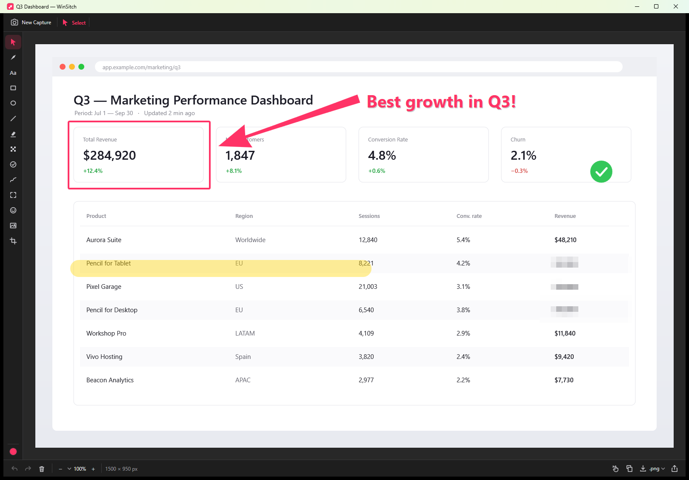
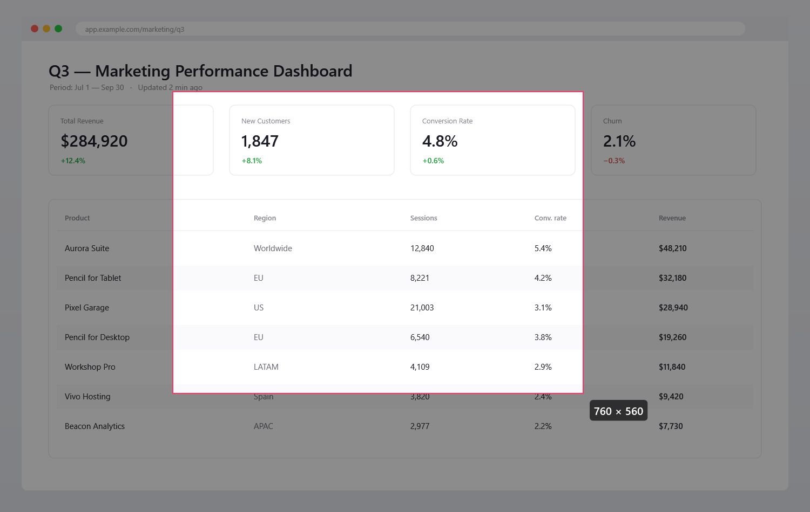
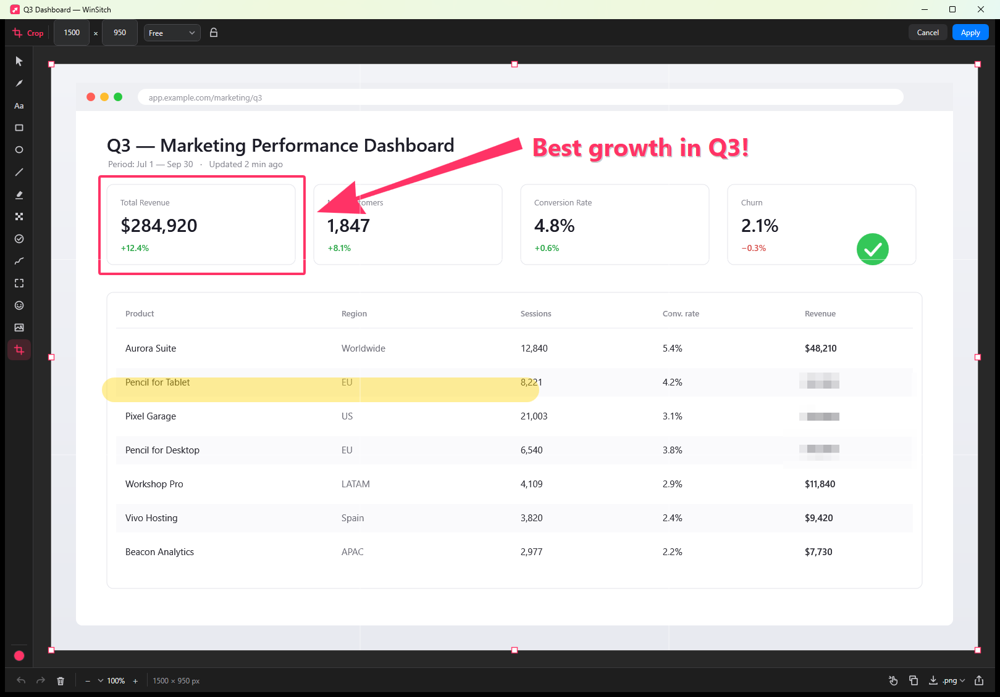
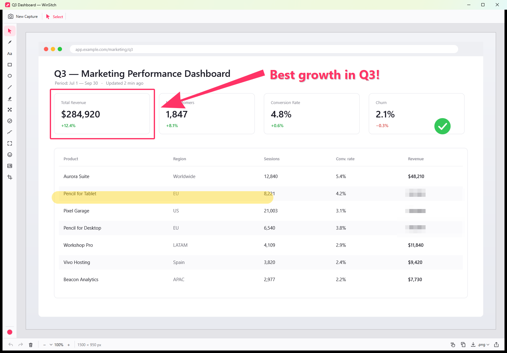
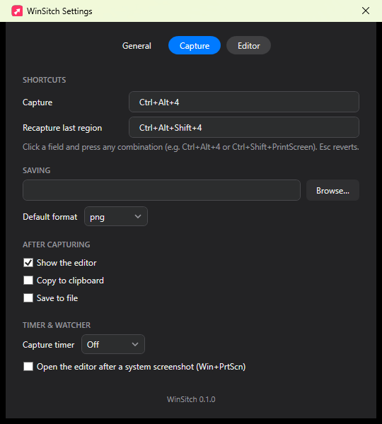

<div align="center">


# Sitch — Skitch for Windows

**The Skitch alternative for Windows.** Capture any region, window or full screen, mark it up
with the iconic tapered arrow, and share it — in seconds, offline, for free.

[](LICENSE)
[](#requirements)
[](#building-from-source)
[](#download)

### [⬇️ Download Sitch for Windows](https://github.com/phalladar/sitch/releases/latest/download/WinSitch.exe)

One standalone file. No installer, no .NET to install — download and run.
*(Formerly **WinSitch**.)*

*Capture. Annotate. Share.* — [Screenshots ↓](#screenshots)

</div>

---

## Is there a Skitch for Windows?

Not anymore. Evernote discontinued **Skitch for Windows in January 2016**, and the remaining
Mac version was abandoned after 2020. If you've been googling *"Skitch for Windows download"*,
*"Skitch alternative for Windows"*, or *"Evernote Skitch replacement"* — this is that tool,
rebuilt natively for the Windows you use today.

Sitch is a free, open-source (MIT) screenshot annotation tool that keeps everything people
loved about Skitch:

- 📸 **Snap-and-mark-up flow** — press a hotkey, drag a region, and the shot opens straight in
  the editor. No dialogs, no file hunting.
- ➹ **The iconic tapered arrow** — thick at the base, fine at the tip. Plus filled, open,
  concave and double-headed variants.
- 🔒 **Privacy first** — no accounts, no tracking, no telemetry, works completely offline.
  Nothing you capture ever leaves your PC.
- 📦 **One standalone .exe** — no installer, no runtime to install, nothing else to download.

## Features

**Capture**
- One hotkey, every mode: `Ctrl+Alt+4` (**fully configurable**) — drag a region, or just *click*
  a window to capture it, or pick a display from the tray
- Keyboard capture: arrow keys define and nudge the selection, `Enter` confirms, `Esc` steps back
- Recapture the last region with one keystroke (`Ctrl+Alt+Shift+4`)
- Freeze-frame picker with live size readout — correct on multi-monitor, mixed-DPI setups
- Window picker that captures clean window content even when partially covered
- Capture timer (3/5/10 s), quick capture straight to clipboard or file
- **Every capture is copied to the clipboard automatically** (on by default) — paste into chat
  before you've even annotated; configurable after-capture actions: show editor / copy / save
- Optional watcher that opens the editor after a system `Win+PrtScn` screenshot

**Annotate — 14 tools**
Select · **Arrow** (tapered/filled/open/concave, double-headed) · Text (any system font, bold,
italic, re-editable later) · Rectangle · Ellipse · Line · Highlighter · **Obscure**
(pixelate / blur / solid block / stripes) · Stamps (✓ ✕ ★ ● + auto-numbering 1·2·3) · Pen ·
**Spotlight** (dim everything but the point you're making) · Emoji stickers · Image overlay ·
non-destructive Crop with aspect-ratio presets

- Everything stays an editable object until export — move, restyle, or delete any mark later
- Redactions are computed from the full-resolution source and flattened only when you export
- Full undo/redo on every change; rotate/flip with annotations following
- Dark, light, or system theme

**Share & export**
- Export **PNG, JPEG, PDF, TIFF**
- Copy to clipboard at full resolution (1×) — high-DPI shots paste pixel-perfect
- **Drag the image out** of the editor straight into Slack, Teams, email, or any app
- Native **Windows Share sheet** integration
- Never saves silently — you always choose where files go

## Download

**[⬇️ Download Sitch for Windows](https://github.com/phalladar/sitch/releases/latest/download/WinSitch.exe)**
(also on the [Releases page](https://github.com/phalladar/sitch/releases)) — a single
self-contained ~86 MB file with the .NET runtime baked in. Run it; it lives in your system tray.
That's the whole install. Delete the file to uninstall.

> Windows SmartScreen may warn on first run (the build is currently unsigned). Choose
> *More info → Run anyway*, or build it from source below.

## Building from source

```powershell
git clone https://github.com/phalladar/sitch
cd sitch
dotnet publish windows/Sitch/Sitch.csproj -c Release -r win-x64 -o publish
# → publish/Sitch.exe  (self-contained single file)
```

Requires the [.NET 10 SDK](https://dotnet.microsoft.com/download). No other dependencies.

## Usage

| Action | Default shortcut |
|---|---|
| Capture (drag = region, click = window) | `Ctrl+Alt+4` *(configurable in Settings ▸ Capture)* |
| Keyboard capture in the overlay | arrows move · `Shift`+arrows resize · `Enter` confirms |
| Recapture last region | `Ctrl+Alt+Shift+4` *(configurable)* |
| Undo / Redo | `Ctrl+Z` / `Ctrl+Y` |
| Copy flattened image | `Ctrl+C` / `Ctrl+Shift+C` |
| Save | `Ctrl+S` |
| Zoom | `Ctrl` `+` / `−` / `0`, `Ctrl`+wheel |
| Crop: apply / cancel | `Enter` / `Esc` |
| Straight lines / squares while drawing | hold `Shift` |

Left-click the tray icon to capture; right-click it for window capture, full-screen per
display, quick capture, the timer, and Settings.

## Sitch vs. Skitch

| | Skitch (Evernote) | **Sitch** |
|---|---|---|
| Windows support | ❌ discontinued Jan 2016 | ✅ Windows 10 & 11 |
| Tapered arrows | ✅ | ✅ (+3 more styles, double-headed) |
| Pixelate | ✅ | ✅ + blur, solid block, stripes |
| Spotlight, stickers, numbered stamps | ❌ | ✅ |
| Account required | Evernote | **None** |
| Cloud upload | forced | **Never** — fully offline |
| Price | — | **Free, MIT open source** |

## FAQ

**What happened to Skitch?**
Evernote bought Skitch in 2011, killed the Windows, iOS and Android versions in January 2016,
and shipped the Mac version's last meaningful update in 2020. It never got an Apple Silicon
build and now crashes on modern macOS.

**Is Sitch really free?**
Yes — free and MIT-licensed. No accounts, no subscription, no "pro" tier, no tracking.

**Does it work on Windows 11? Windows 10?**
Both. It requires Windows 10 version 1903 or later, including all Windows 11 releases.

**Does it handle multiple monitors and display scaling?**
Yes — capture is per-monitor-DPI aware and grabs true physical pixels, including drags that
span monitors with different scale factors.

**How do I hide passwords or secrets in a screenshot?**
Use the Obscure tool. For real secrets prefer **solid block or stripes** — blur and pixelation
are filters and can sometimes be partially reversed. Sitch flattens redactions into the
pixels when you export, so nothing can be "un-hidden" from the file.

**Can I change the capture hotkey?**
Yes — Settings ▸ Capture, click the shortcut field, and press any combination.

## Requirements

- Windows 10 1903+ or Windows 11 (x64)
- No runtime, no installer, no admin rights required

## Known limitations (v0.1)

- Emoji stickers render monochrome on some systems (WPF color-font limitation)
- HDR displays are captured in SDR (tone-mapped capture is on the roadmap)
- The binary is unsigned, so SmartScreen shows a first-run warning

## Architecture notes

Native WPF on .NET 10. Freeze-frame GDI capture with one overlay window per monitor
(Per-Monitor-V2 DPI, physical-pixel coordinate space — the approach that avoids the classic
mixed-DPI capture bugs). The pristine capture is immutable: every annotation, including
blur/pixelate, is a vector object rendered non-destructively and flattened only at export,
with effects applied before shapes so redactions never smear your arrows. Clean-room
implementation; architecture lessons drawn from studying the classic Skitch, its modern macOS
remake [iSkitch](https://iskitch.com), and the open-source annotation-tool ecosystem.

## Screenshots

*The editor — dark theme, with the signature tapered arrow, highlighter, pixelate redaction and
a numbered-workflow stamp:*



*Region capture — frozen-screen picker with dimming and a live pixel-size readout:*



*Non-destructive crop with aspect-ratio presets, proportional lock and rule-of-thirds grid:*



*Light theme:*



*Settings — the capture hotkey is fully configurable:*



---

<div align="center">

**Sitch** — screenshot annotation for Windows: capture, annotate & share.
A free, open-source Skitch replacement. MIT © 2026 Josh Auriemma

</div>
